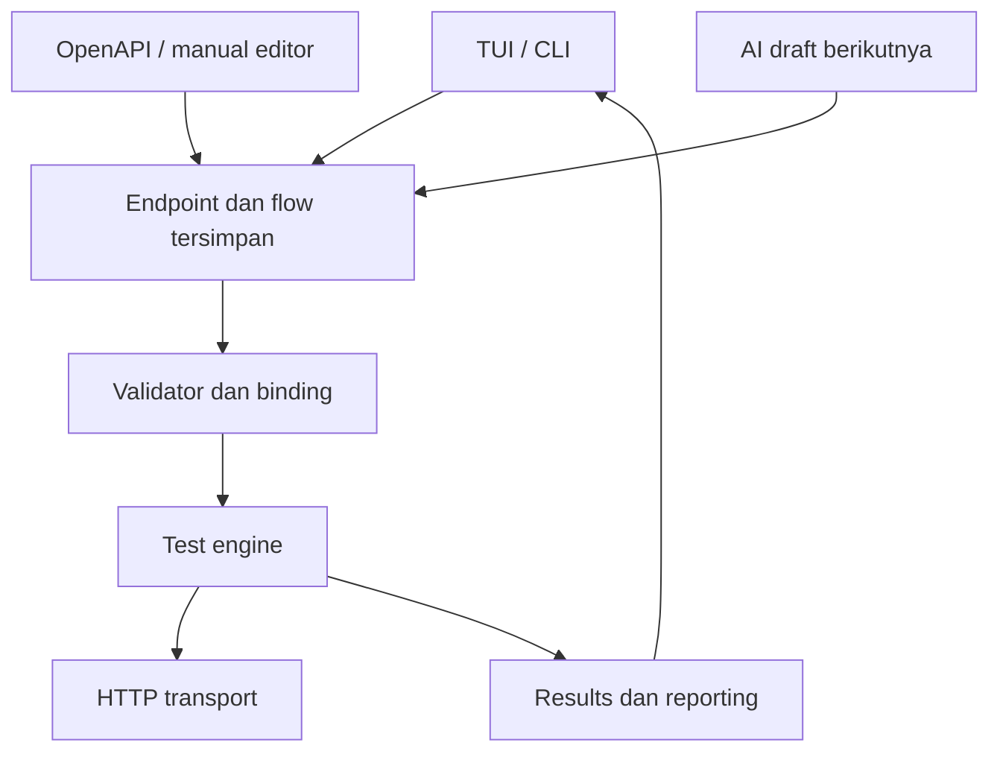

> **Arsip.** Rencana ini digantikan oleh `docs/PLAN.md` (Small Core Proof, 9 Oktober 2026). Jangan dijalankan; disimpan sebagai referensi roadmap.

# API Toolkit — Rencana Flow Builder dan Test Engine

Tanggal: 8 Oktober 2026  
Target: v0.1 functional flow testing  
Status: baseline v0.1 (revisi 1) siap dieksekusi di harness; belum merupakan implementasi.

Dokumen ini memperbarui rencana awal. Pengguna telah menetapkan prioritas flow builder/test engine, AI setelah v0.1, OpenAPI 3.0.x dan 3.1.x untuk impor awal, serta JSON/raw text dengan autentikasi token/API key/basic. Pilihan teknis lainnya ditetapkan sebagai default implementasi dalam dokumen ini dan tidak perlu menjadi pertanyaan produk baru saat harness bekerja.

Revisi 1 (8 Oktober 2026): engine dan CLI headless dibangun sebelum TUI; OpenAPI import dipindah ke setelah flow builder dan menerima 3.0.x; ditambahkan node `concat`, assertion array, file `.env` lokal, serta editor body melalui `$EDITOR`. Keputusan boleh berubah setelah review pengguna; perubahan dicatat di decision log repository (bagian 19).

## 1. Tujuan dan hasil akhir

Pengguna dapat menyusun pengujian API multistep melalui TUI, menyimpan flow sebagai data, menjalankannya pada environment berbeda, memeriksa hasil setiap step, dan memakai flow yang sama dalam CI/CD tanpa AI.

Skenario acuan: login → membuat resource → mengambil ID → membaca dan memverifikasi resource → menghapus resource melalui cleanup. Keberhasilan v0.1 diukur dari kemampuan menyelesaikan alur ini dengan hasil yang dapat dipercaya dan ditelusuri.

Flow builder menghasilkan definisi pengujian eksplisit. Test engine mengeksekusinya. Katalog endpoint dari OpenAPI dan input manual menjadi sumber bersama. Mock server, AI, dan pemeriksaan keamanan berkembang di atas fondasi yang sama.

## 2. Keputusan pengguna dan default implementasi

### 2.1 Keputusan yang sudah diberikan

| Aspek | Keputusan pengguna |
| --- | --- |
| Bahasa | Rust; belajar melalui proyek dengan implementasi berbantuan AI |
| Antarmuka | TUI |
| Sumber endpoint | Hybrid: OpenAPI import dan manual endpoint creation |
| Versi spesifikasi | OpenAPI 3.0.x dan 3.1.x pada v0.1 dengan subset terdokumentasi; Swagger 2.0/3.2 kemudian |
| Bantuan AI | Opsional dan baru diintegrasikan setelah v0.1; kontrak draft disiapkan pada fondasi |
| Request/auth awal | JSON/raw text, bearer/API key/basic, dan token dari login step; tanpa cookie jar atau OAuth acquisition otomatis |
| Persistensi | Endpoint, flow, dan hasil pengujian disimpan dan dapat diekspor |
| Otomasi | Definisi pengujian bisa digunakan di CI/CD tanpa AI |
| Prioritas sekarang | Flow builder dan test engine |
| Fitur lanjutan | Mock server, stability/security testing, serta pelaporan kerentanan/CVSS |

### 2.2 Default implementasi yang berlaku

| Pilihan | Default implementasi | Alasan |
| --- | --- | --- |
| Flow awal | Sequential; satu run aktif per proses | Diagnosis dan dependency sederhana |
| Urutan pembangunan | Engine + CLI headless dulu, lalu TUI, lalu OpenAPI import | Hasil nyata lebih cepat; TUI dibangun di atas model yang sudah terbukti |
| OpenAPI awal | 3.0.x dan 3.1.x dengan subset terdokumentasi | Generator umum (NestJS Swagger, drf-spectacular) masih menghasilkan 3.0.x |
| Payload awal | Literal, typed bindings, `concat` string, dan pemilihan contoh secara manual | Nama/email unik per run tanpa scripting |
| Auth awal | Bearer, API key header/query, basic; token dari login step | Mendukung alur API umum |
| Penyimpanan | Satu `project.json` ber-version; hasil run terpisah | Atomic save sederhana; pemisahan lewat migration nanti |
| Secret lokal | Host env var; `.env` di folder proyek dibaca otomatis oleh TUI, oleh CLI hanya via `--env-file` | TUI praktis; CI tetap eksplisit |
| Input teks TUI | Crate textarea siap pakai (kandidat `tui-textarea`); body panjang dibuka di `$EDITOR` | Tidak membangun editor multiline sendiri |
| Platform pertama | Linux terminal | Sesuai lingkungan kerja pengguna |
| Struktur Rust | Satu package dengan library core dan binary | Modular tanpa banyak crate sejak awal |
| Kandidat dependency | Ratatui/Crossterm, Tokio, Reqwest, Serde, Clap, dotenvy, crate OpenAPI (dipilih saat F5) | Kandidat yang diuji saat bootstrap; versi dikunci kemudian |
| Laporan | Canonical JSON, ringkasan terminal, JUnit adapter | Debugging dan integrasi CI |

Tabel ini menjadi baseline bagi harness. Keputusan produk yang dikonfirmasi pengguna dicatat pada bagian 2.1 dan 17; rincian teknis lainnya adalah default yang ditetapkan dalam perencanaan. Nama sementara binary/package adalah `api-toolkit`. Pemilihan versi dependency yang compatible dilakukan saat F0 dan dikunci; tidak memerlukan keputusan produk tambahan. Provider AI dan desain plugin dinamis tidak dibutuhkan untuk v0.1.

## 3. Batas v0.1 dan jalur pengembangan

| Area | v0.1 | Berikutnya |
| --- | --- | --- |
| Endpoint | Manual + OpenAPI 3.0.x/3.1.x subset | Swagger 2.0/3.2; reimport merge |
| Flow editor | Create/edit/duplicate/reorder/disable; validasi | Branch, loop, subflow, graph |
| Data antarstep | Typed bindings; `concat` string; JSON Pointer/header/status extraction | Transform, JSONPath, dataset |
| Assertions | Status, header, JSON field/type/value, panjang array, array memuat item, body text, duration | Full schema conformance; expression |
| Engine | Sequential; stop/continue; deadline; cleanup; cancel | Parallel groups, polling, controlled retry |
| Auth | Secret references; profile per flow/step; login flow | OAuth acquisition/refresh, cookie jar, mTLS |
| Request body | JSON, raw text, tanpa body | Form, multipart, upload/binary |
| Payload generator | Memilih contoh yang tersedia | Deterministik/random ber-seed; negative generation |
| CI | Headless run; JSON/JUnit; exit code; export/import | Suite/matrix execution, trends |
| AI | Kontrak draft flow dipersiapkan | Suggestions + apply/edit/reject |
| Mock server | Mempertahankan schema/examples dalam model | Stateless, kemudian stateful mock |
| Security | Negative case manual tetap bisa dibuat | Authorization regression, race/rate-limit scenarios |
| Findings/CVSS | Belum tersedia | Evidence → candidate finding → review → scoring |

Tidak termasuk v0.1: arbitrary scripts, shell hooks, distributed runners, scheduler, SaaS dashboard, plugin registry, atau klaim schema validation lengkap. Kebutuhan yang deferred tidak menjadi blocker rilis pertama.

Pengguna tetap bisa membuat tes manual yang mengharapkan status 400/401/403. Itu functional negative testing, belum vulnerability scanning.

## 4. User journeys dan pengalaman TUI

### 4.1 Journey utama

1. Membuat atau membuka proyek.
2. Membuat endpoint manual atau mengimpor OpenAPI.
3. Meninjau endpoint dan diagnostic impor.
4. Mengatur environment, auth profile, dan input nonsecret.
5. Membuat flow dan menambahkan endpoint sebagai step.
6. Menentukan request bindings, extractor, assertion, failure policy, dan cleanup.
7. Validate → preview → save → run.
8. Melihat hasil step, assertion, request/response redacted, dan cleanup.
9. Menjalankan ulang atau mengekspor proyek untuk CI/CD.

Flow tidak disimpulkan benar hanya dari kemiripan path. User menentukan urutan bisnis dan dependency. Heuristik/AI di masa depan hanya mengusulkan draft.

### 4.2 Layout dan interaksi

Navigasi utama: Endpoints, Flows, Environments, Runs. Halaman Flows memiliki daftar flow, daftar step berurutan, dan panel detail. Detail step memakai tab Request, Extract, Assert, Policy. Cleanup tampil sebagai kelompok terpisah.

| Aksi editor | Perilaku |
| --- | --- |
| Create/rename flow | Nama dapat berubah; ID tetap |
| Duplicate flow | ID flow/step baru; binding internal diremap |
| Add step | Memilih endpoint; input wajib yang belum lengkap ditandai |
| Edit step | Override parameter/body/auth, extractor, assertion, policy |
| Reorder | ID tetap; validator mendeteksi forward dependency |
| Disable | Tersimpan; consumer output step disabled memblokir run |
| Delete | Consumer terdampak ditampilkan agar dapat diperbaiki |
| Duplicate step | ID baru; consumer lama tetap merujuk step asli |
| Add cleanup | Daftar tersendiri dengan urutan dan prerequisite |
| Validate | Diagnostic menunjuk flow/step/field yang dapat dibuka |
| Save | Atomic save untuk struktur valid, termasuk draft yang belum runnable |
| Run | Snapshot immutable dari versi tersimpan |

Shortcut usulan: `a` add, `e` edit, `d` duplicate, `Space` toggle, `Alt+Up/Down` reorder, `Ctrl+S` save, `v` validate, `r` run, `Esc` back. Shortcut tidak mengambil karakter ketika text input aktif. Footer menunjukkan aksi yang tersedia.

Field teks pendek memakai widget textarea siap pakai (kandidat `tui-textarea`). Body dan nilai panjang dapat dibuka di `$EDITOR` (fallback `vi`): TUI keluar sementara dari raw mode, membuka file sementara, lalu memulihkan terminal dan memvalidasi isi saat kembali. Yang diedit di `$EDITOR` adalah JSON literal biasa dari node `template` (bagian 6.2); binding per field diatur di tab Request sebagai daftar JSON Pointer → nilai, sehingga pengguna tidak perlu menulis tagged node secara manual. Jika JSON invalid, isi tetap disimpan sebagai draft dengan diagnostic lokasi; editan tidak boleh hilang. Editor inline cukup mendukung multiline dan paste. Tidak perlu menjadi IDE. Preview menampilkan input resolved yang tersedia dan label unresolved untuk output step yang belum berjalan. Kredensial tetap redacted.

Draft incomplete boleh disimpan jika struktur file valid. Runnable validity diperiksa terpisah. Saat Run dengan perubahan belum disimpan, UI menawarkan save-and-run atau memakai versi tersimpan.

Selama run, pengguna dapat melihat step aktif, durasi, hasil individual assertion, dan cancel. Request jaringan tidak memblokir input/resize. Terminal kecil menampilkan pesan ukuran minimum tanpa menghapus draft. Terminal raw mode harus pulih pada exit/error/panic.

## 5. Katalog endpoint dan OpenAPI

### 5.1 Model bersama

`EndpointDefinition` mencakup ID stabil, label, method, path, parameter/serialization, pilihan media type, contoh, raw schema, respons/auth metadata, dan provenance. Manual dan imported endpoints menggunakan model yang sama.

Rename label tidak mengubah endpoint ID. Flow tidak merujuk display name. Method/path dari source tidak boleh berubah diam-diam oleh heuristik atau AI. Raw source dipertahankan untuk fitur schema generator/mock berikutnya.

### 5.2 Capability matrix impor awal

| Komponen | Cakupan v0.1 | Batasan/diagnostic |
| --- | --- | --- |
| Dokumen | JSON/YAML lokal, OpenAPI 3.0.x dan 3.1.x | Swagger 2.0, 3.2, atau versi tak dikenal ditolak dengan diagnostic; tidak ditebak |
| Perbedaan 3.0/3.1 | `nullable`, `example`/`examples`, exclusive min/max dinormalisasi ke metadata model | Raw schema asli tetap disimpan sesuai versinya; normalisasi tidak mengubah source |
| Path/method | Operasi HTTP yang supported oleh client | Path dipertahankan; konflik dilaporkan |
| Parameter | Primitive path/header; primitive dan array query `form` | Style/shape lain needs_review |
| Query arrays | `explode=true`: key berulang; `false`: comma-separated | Jangan mengubah array menjadi string sembarang |
| Request body | JSON/raw text dan media type pilihan | Multipart/form/binary dicatat tetapi tidak runnable |
| Schema | Raw schema disimpan | Tidak ada klaim full JSON Schema validation |
| Reference | Local in-document ref pada subset didukung | External ref, custom base URI/dialect, dan siklus resolver didiagnosis |
| Examples | Inline examples dapat dipilih | External example tidak diunduh |
| Servers | Kandidat base URL environment | Server variables harus diselesaikan sebelum run |
| Auth metadata | Requirement dipertahankan; dipetakan ke profile | Scheme unsupported perlu explicit override |
| Links/callbacks/webhooks | Dipertahankan dalam source | Tidak otomatis dijalankan |

Endpoint parsial boleh masuk katalog sebagai `needs_review`, tetapi runner memblokir konstruksi executable yang unsupported. Override mencatat bagian yang diganti. Impor/preview/validate tidak menghubungi jaringan dan tidak memerlukan AI.

Parameter inheritance/override dan security alternatives/conjunction harus dipertahankan. User memilih auth profile yang memenuhi requirement atau explicit override untuk negative testing; editor tidak menyamakan semua scheme menjadi bearer.

Reimport v0.1 memasukkan katalog ke namespace baru, lalu remap manual. Tidak menimpa endpoint yang dipakai flow. Merge otomatis menjadi fitur berikutnya.

Desain mengikuti kontrak [OpenAPI 3.0.3](https://spec.openapis.org/oas/v3.0.3.html) dan [OpenAPI 3.1](https://spec.openapis.org/oas/v3.1.0.html). Feature set ditentukan major/minor, sehingga keluarga 3.0 dan 3.1 tidak dibatasi hanya string patch tertentu. Satu adapter per keluarga menghasilkan `EndpointDefinition` yang sama; provenance mencatat versi source. Capability matrix tetap wajib karena dukungan versi tidak berarti seluruh konstruksi sudah runnable.

Pemilihan crate parser dilakukan dengan spike pada F5. Dukungan crate Rust untuk 3.0 dan 3.1 berbeda-beda; jika tidak ada satu crate yang memadai, parsing dapat memakai `serde_json::Value`/YAML generik dengan model internal sendiri untuk subset capability matrix.

## 6. Kontrak flow, variabel, dan binding

### 6.1 Struktur flow

`FlowDefinition`: ID, nama, deskripsi, tags, variables, default policy, ordered normal steps, ordered cleanup. `StepDefinition`: ID, label, enabled, endpoint ID, overrides, extractors, assertions, policy.

Environment dipilih saat run. Flow portabel tidak mengunci hostname atau credential produksi. Semua IDs stabil sepanjang rename/reorder.

### 6.2 Namespace

| Namespace | Sumber | Aturan |
| --- | --- | --- |
| `project` | Nonsecret default proyek | Immutable dalam run |
| `environment` | Nonsecret environment terpilih | Immutable dalam run |
| `flow` | Input/default flow; override CI | Immutable setelah run dimulai |
| `runtime` | Run ID/waktu mulai | Dibuat engine |
| `steps.<id>.outputs.<name>` | Extractor step yang passed | Ditulis sekali; tidak dibawa ke run lain |
| `secret` | Host env var, lalu `.env` lokal (bagian 9) | Tidak disimpan/export |

Tidak ada fallback otomatis antar-namespace. Scope bernama eksplisit mencegah default tersembunyi menimpa input. Step gagal tidak mempublikasikan normal outputs.

ID internal dan nama output dibatasi ke huruf, angka, underscore, dan hyphen agar dot-path binding tidak ambigu. Nama tampilan tidak mengikuti batasan ini. Input CI hanya boleh mengubah namespace `flow`; runtime/output/secret tidak dapat ditimpa lewat file input.

Request value berbentuk tagged node:

| Node | Isi | Hasil |
| --- | --- | --- |
| `literal` | JSON value | Nilai apa adanya |
| `ref` | Satu path namespace | Nilai typed dari namespace |
| `object` | Map nama → node | JSON object |
| `array` | Daftar node | JSON array |
| `concat` | Daftar node `parts` | String gabungan |
| `template` | JSON literal + daftar binding `pointer` → node | JSON literal dengan nilai pada pointer diganti hasil node |

`concat` hanya menerima part yang ter-resolve menjadi string, number, atau boolean. Number diformat kanonis (tanpa eksponen untuk integer), boolean menjadi `true`/`false`. Null, object, array, atau part absent adalah binding error, bukan string kosong. Jika satu part sensitive, hasilnya sensitive. Contoh: `toolkit-` + `runtime.run_id` untuk nama unik per run.

`template` dipakai terutama untuk body. Setiap pointer binding harus menunjuk lokasi yang ada di JSON literal (divalidasi statis), dan satu pointer hanya boleh di-bind sekali. Penggantian whole-value mempertahankan tipe hasil node.

Arbitrary expression/script, fungsi transform, dan sintaks placeholder di dalam string (misalnya `{{...}}`) tetap ditunda.

Whole-value binding mempertahankan tipe. `false`, `0`, empty string, dan JSON null bukan missing. Serializer path/query/header mengubah primitive menjadi teks menurut aturan eksplisit; JSON body mempertahankan tipe.

Secret reference dan output yang ditandai sensitive membawa metadata sensitivitas sampai reporting, termasuk jika dipakai dalam body, query, atau assertion expected value.

### 6.3 Extractor

| Source | Selector | Output |
| --- | --- | --- |
| JSON | JSON Pointer, misalnya `/data/id` | Nilai typed |
| Header | Nama case-insensitive; first/all eksplisit | String atau array string |
| Status | HTTP status | Integer |

Extractor mendefinisikan name, source, selector, expected type, required, sensitive, dan optional cleanup capture. Required missing/type mismatch menjadi execution error. Optional missing menghasilkan output absent, bukan null.

JSON Pointer mengikuti [RFC 6901](https://www.rfc-editor.org/rfc/rfc6901.html), termasuk `~0`/`~1`, array index, dan empty pointer untuk root. Pointer invalid dideteksi sebelum run; location absent diperiksa setelah respons.

### 6.4 Cleanup capture

Extractor `capture_for_cleanup=true` menyimpan nilai ke namespace internal `cleanup_capture.<step_id>.<name>` setelah respons dibaca, sebelum assertion menentukan verdict. Namespace ini hanya boleh digunakan cleanup.

Jika create menghasilkan ID tetapi assertion create gagal, cleanup tetap memiliki ID. Normal step selanjutnya tidak boleh menggunakan capture ini sebagai output valid. Jika timeout terjadi sebelum respons diterima, ID mungkin tidak diketahui; engine melaporkan resource berpotensi tersisa tanpa menebak ID atau mengulang create.

## 7. Assertion dan verdict

### 7.1 Assertion v0.1

| Kind | Pemeriksaan |
| --- | --- |
| `status_in` | HTTP code dalam set expected |
| `header_exists` | Header tersedia |
| `header_equals` | Nilai header first/all sesuai expected |
| `json_exists` | Pointer tersedia, termasuk nilai null |
| `json_type` | Tipe JSON field sesuai |
| `json_equals` | Nilai field sama dengan typed expected binding/literal |
| `json_compare` | Perbandingan numeric dengan operator eksplisit |
| `json_length` | Panjang array pada pointer dibandingkan dengan operator eksplisit (`eq`, `ne`, `gt`, `gte`, `lt`, `lte`) |
| `json_array_contains` | Array pada pointer memuat elemen yang sama dengan expected; opsional `item_pointer` untuk membandingkan field di dalam tiap elemen |
| `body_contains` | Body teks memuat string expected |
| `duration_lt_ms` | Total request duration di bawah threshold |

Expected binding hanya memakai namespace yang tersedia sebelum step berjalan. Current response diperiksa langsung melalui selector, tanpa mempublikasikan current output terlebih dahulu. Semua assertion dievaluasi dan hasilnya dicatat.

Assertion JSON pada body non-JSON gagal dengan reason `invalid_json`. Pointer absent membuat assertion field gagal. Engine tidak menilai body terpotong sebagai JSON valid. Header content checks dan numeric comparisons memiliki type rules eksplisit.

`json_length` dan `json_array_contains` gagal dengan reason `not_array` jika nilai pada pointer bukan array. Kesamaan elemen memakai deep equality JSON bertipe: `1` tidak sama dengan `"1"`, dan urutan key object tidak berpengaruh. Contoh "resource baru muncul di list": pointer `/data`, `item_pointer` `/id`, expected `ref` ke `steps.create.outputs.widget_id`. Elemen yang tidak memiliki `item_pointer` dilewati, bukan error. Pencarian dibatasi oleh response body limit; tidak ada pagination otomatis.

### 7.2 Aturan lulus

Setiap step enabled membutuhkan assertion eksplisit. Flow tanpa normal step enabled bukan successful empty run. Disabled step keluar dari denominator; step blocked oleh failure tetap tercatat skipped dan tidak membuat run hijau.

| Dimensi | Status | Arti |
| --- | --- | --- |
| Execution | completed/error/cancelled/skipped | Apakah request dan evaluasi dapat diselesaikan |
| Verification | passed/failed/not_evaluated | Apakah assertion terpenuhi |

HTTP 500 adalah request completed; bisa passed jika memang expected. Timeout jaringan adalah execution error. Assertion failure bukan otomatis vulnerability. Threshold latency hanya observasi run, belum benchmark SLA.

Run passed membutuhkan semua enabled normal step passed dan cleanup mandatory yang applicable berhasil. Error primer dan sekunder tetap terlihat; cleanup tidak menutupi penyebab awal.

Semua cleanup enabled yang prerequisite-nya terpenuhi dianggap mandatory pada v0.1. Jika extractor error dan assertion mismatch terjadi bersama, keduanya dicatat, tetapi execution error menentukan kategori akhir step. Step yang di-skip karena stop/dependency dari failure yang sudah tercatat tidak menambah execution error baru; category mengikuti penyebab asal. Incomplete berarti evaluasi terhenti tanpa hasil final yang sah, bukan sekadar sisa step yang sengaja dilewati oleh failure policy.

## 8. Test engine: lifecycle dan policies

### 8.1 Lifecycle

1. Load dan validasi format/version/reference.
2. Pilih flow/environment; resolve secrets tanpa mencetak nilai.
3. Validasi statis seluruh flow sebelum mengirim request apa pun.
4. Buat immutable snapshot, run ID, artifact awal, dan cancellation scope.
5. Per step: resolve input → build request → dispatch → collect bounded response → evaluate extractors/assertions → publish outputs hanya jika passed → persist/emit result.
6. Terapkan stop/continue pada failure/error; tandai remaining/blocked step dengan reason.
7. Jalankan cleanup applicable menurut urutan dan budget.
8. Simpan hasil akhir, report, aggregate status, dan exit code.

Validator memeriksa ID duplikat, endpoint/reference hilang, forward dependency, disabled producer, body syntax, serializer support, URL, parameter wajib, assertion kind, dan cleanup prerequisite. Static validation tidak mengklaim tahu response runtime; binding konkret divalidasi lagi tepat sebelum dispatch.

### 8.2 Default eksekusi

| Setting | Default |
| --- | --- |
| Ordering | Sequential; satu run aktif |
| On failure | Stop normal steps; continue dapat dipilih per step |
| Automatic retry | Tidak tersedia; attempts=1 |
| Connect timeout | 5 detik |
| Total request timeout | 30 detik, termasuk body read |
| Normal-flow deadline | 5 menit |
| Cleanup deadline | Budget terpisah 30 detik |
| Response body limit | 5 MiB |
| Redirect | Tidak diikuti |
| TLS verification | Aktif; tanpa global bypass pada v0.1 |
| System proxy inheritance | Nonaktif; explicit config kemudian |
| Cookie persistence | Tidak tersedia |

Timeout/deadline/body limit dapat dikonfigurasi. Nilai ini default produk, bukan estimasi performa. Request cleanup memakai timeout yang dibatasi sisa budget cleanup.

`continue` menjalankan step independen berikutnya, tetapi verdict flow tetap gagal/error. Consumer output step gagal menjadi `skipped/dependency_unavailable`, bukan request dengan string kosong atau data run lama.

Tidak ada retry otomatis: request timeout bisa sudah diproses server. Outcome server yang tidak diketahui dicatat.

### 8.3 Request preparation

- Base URL adalah origin HTTP/HTTPS dan base path konkret, tanpa embedded credential/query/fragment.
- Base `https://host/api/v1` + path `/users/{id}` menjadi `/api/v1/users/<encoded-id>`; jangan kehilangan base path.
- Path literal/trailing slash dipertahankan; parameter di-encode sebagai nilai, tidak boleh mengganti origin.
- Query berupa ordered pairs agar repeated keys tidak hilang.
- Header dibandingkan case-insensitive. Konflik auth profile/header eksplisit ditolak.
- Auth `none` tersedia untuk negative testing; profile berlaku default pada flow dan dapat dioverride step.
- JSON override mengganti whole body, tanpa implicit deep merge.
- Schema/required input checks dapat dioverride secara eksplisit untuk negative payload. Binding validity, URL validity, dan serializer support tetap wajib.
- Import/preview/validate tidak dispatch HTTP.

HTTP adapter menetapkan timeout, redirect, dan proxy behavior secara eksplisit, bukan mengandalkan default client. Reqwest tidak memiliki batas ukuran body bawaan, jadi body dibaca per chunk dan dihentikan saat melewati limit; respons yang terpotong ditandai `body_truncated`, dan assertion JSON terhadapnya gagal, bukan dievaluasi sebagian. `Content-Length` tidak dipercaya sebagai satu-satunya batas. Rujukan kandidat: [Reqwest ClientBuilder](https://docs.rs/reqwest/latest/reqwest/struct.ClientBuilder.html).

### 8.4 Cleanup

Cleanup merupakan request biasa dengan endpoint, input, assertion, timeout, dan prerequisite `capture_exists`/`output_exists`. Default dijalankan setelah success, assertion failure, execution error, atau normal-flow deadline selama proses hidup.

Prerequisite absent menghasilkan `skipped/not_applicable`. Jika prerequisite tersedia tetapi cleanup gagal, status failed/error. Cleanup applicable berikutnya tetap dicoba walau cleanup sebelumnya gagal, selama budget masih tersedia.

Cleanup applicable yang tidak sempat dijalankan karena budget habis menghasilkan run error. Cleanup bukan rollback transaksi dan tidak menjanjikan semua side effect terhapus.

### 8.5 Cancel dan crash

Cancel menghentikan dispatch normal berikutnya dan membatalkan active client wait. Transaksi server yang sudah berjalan tidak otomatis batal.

Default cancel tidak mengirim cleanup baru. Run setting `cleanup_on_cancel=true` mengizinkan cleanup dengan cancellation scope baru dan budget terpisah. Cancel kedua menghentikan semuanya. Final run tetap cancelled walaupun cleanup sukses.

Hasil parsial ditulis atomik setelah setiap step. Crash/force kill dapat menyisakan artifact incomplete; saat dibuka ulang tidak boleh dianggap passed. Tidak menjanjikan flush/cleanup setelah force kill.

## 9. Environment, auth, dan redaction

Environment menyimpan base URL dan nonsecret variables. Auth profile menyimpan scheme dan secret reference seperti `secret.API_TOKEN`, yang dipetakan ke nama variabel. CLI tidak meminta token lewat argumen command line.

Sumber nilai secret:

| Sumber | TUI | CLI |
| --- | --- | --- |
| Host environment variable | Ya | Ya |
| `.env` di direktori yang sama dengan `project.json` | Dibaca otomatis jika ada | Tidak dibaca |
| File via `--env-file <path>` | Tidak relevan | Dibaca hanya jika flag diberikan |

Host env var menang atas nilai `.env` dengan nama sama. Format `.env` mengikuti dotenv sederhana (`KEY=VALUE`, komentar `#`, quoting); kandidat parser `dotenvy`. Isi `.env` hanya mengisi namespace `secret` dan tidak pernah disalin ke project, result, report, atau bundle export. Exporter selalu mengecualikan `.env`; TUI memberi peringatan jika `.env` ada di proyek yang berada dalam git repository tetapi tidak di-ignore. Run result mencatat nama sumber secret (env/dotenv) per reference, bukan nilainya.

Login flow memakai secret binding pada input; extractor token diberi sensitive. Token berlaku hanya dalam run, tidak dibaca dari run history. Alias profile `admin`, `user_a`, `user_b` menyediakan fondasi authorization testing kemudian.

Field token/API-key/username/password pada profile merupakan typed value nodes, sehingga token dapat berasal dari `secret.API_TOKEN` atau `steps.login.outputs.access_token`. Dependency profile diperiksa pada tiap step yang memakainya; login step sendiri memakai `auth=none` atau profile berbeda. Dynamic token tidak harus tersedia saat validasi statis, tetapi producer dan tipe binding harus sah. Environment base URL hanya memakai nilai statis yang terselesaikan sebelum dispatch.

Redaksi mencakup auth/API-key header, secret query/body bindings, sensitive extractor/output, assertion expected value, error messages, serta configured JSON pointers. URL di report meredaksi secret query.

Body sensitif non-JSON atau body yang redaksinya tidak dapat dijamin dihilangkan dari persistence; report mencatat `body_omitted_for_redaction`. v0.1 tidak menyediakan raw unredacted export.

Source OpenAPI dapat memuat secret dalam examples. Exporter menerapkan redaction policy atau menolak source yang tidak dapat diekspor aman, bukan menganggap source selalu bebas secret. Persistensi/export tidak menjamin deteksi otomatis seluruh PII arbitrer.

## 10. Persistence, format version, dan report

### 10.1 Layout

Baseline: `project.json` berisi metadata, endpoints, environments, auth profiles, dan flows; `sources/` berisi snapshot impor; `runs/<run-id>/` berisi canonical result dan snapshot redacted.

Satu file definisi mendukung atomic save dan dikonfirmasi pengguna untuk v0.1. Agar diff git tetap terbaca, serializer menulis JSON pretty-printed secara deterministik: urutan key stabil, endpoint dan flow diurutkan menurut ID, dan save tanpa perubahan semantik menghasilkan byte yang sama. Pemecahan `endpoints`/`flows` ke file terpisah ditambahkan melalui migration jika katalog impor besar atau kolaborasi menuntutnya. Proyek/flow tidak menyimpan runtime secret, hostname hardcoded pada flow, atau path absolut dependency workstation.

| Model | Data minimum |
| --- | --- |
| Project | format version, ID/name, definitions |
| EndpointDefinition | Stable ID, request metadata, source location, readiness |
| FlowDefinition | Variables, policies, ordered steps/cleanup |
| PreparedRequest | Resolved method/URL/header/body dengan sensitivity metadata |
| RunContext | Snapshot, scope values, run ID, cancellation |
| StepResult | Execution/verification, attempts, duration, redacted request/response, assertions/errors |
| RunResult | Result version, config hash, environment ID, normal/cleanup summaries, final state |

Result menyimpan app version, timestamps UTC, monotonic durations, timeout config, source/config hashes, dan reason codes. Hash dihitung dari normalized nonsecret config + secret reference names; tidak meng-hash credential sebagai fingerprint. Reproduksi memakai definisi sama, tetapi tidak menjamin state/response server identik.

### 10.2 Integritas

- Definisi pertama `format_version=1`; hasil pertama `result_version=1`.
- Version baru/unknown executable kind/field ditolak. Tidak silently drop lalu overwrite.
- Metadata extensible hanya di slot `extensions` terdokumentasi yang tidak dieksekusi.
- Save: temp file pada direktori yang sama → flush → atomic rename; kegagalan mempertahankan file lama.
- Satu writer lock; proses kedua mendapat read-only/locked diagnostic.
- History dapat dibuka setelah source/endpoint berubah tanpa secret runtime.
- Export ZIP memuat manifest, definitions, dan source aman; runs opt-in.
- Bundle import memeriksa traversal, ukuran, checksums, versi, dan destination; tidak menimpa proyek lain diam-diam.

### 10.3 CLI surface yang diusulkan

Nama binary sementara `api-toolkit`; perintah ini kontrak rencana, belum implementasi.

```bash
api-toolkit tui --project ./project.json
api-toolkit validate --project ./project.json --flow lifecycle --env staging
api-toolkit run --project ./project.json --flow lifecycle --env staging --input-json ./ci-inputs.json --report-json ./artifacts/run.json --report-junit ./artifacts/junit.xml
api-toolkit run --project ./project.json --flow lifecycle --env local --env-file ./.env
api-toolkit report --run ./runs/<run-id>/result.json
api-toolkit export --project ./project.json --output ./api-tests.zip
api-toolkit import --bundle ./api-tests.zip --destination ./api-tests
```

`validate` tidak menghubungi API. `run` menjalankan flow yang dipilih, tidak seluruh katalog. CLI tidak membuka TUI, meminta input, atau memanggil AI. Progress ke stderr; report sesuai output path. Secret berasal dari host env, ditambah `--env-file` jika diberikan; CLI tidak membaca `.env` secara implisit. Input JSON hanya nonsecret flow inputs.

| Exit code | Makna |
| --- | --- |
| 0 | Enabled normal steps passed; cleanup applicable sukses |
| 1 | Assertion failure tanpa execution/reporting error |
| 2 | Config/unsupported/binding/network/timeout/cleanup/report error atau verification incomplete |
| 130 | Cancel pengguna |

Precedence: cancelled → error/incomplete → failed → passed. Error cleanup tidak menghapus failed assertion dari report. Save-report failure tidak menghasilkan code 0.

JUnit memetakan enabled normal step dan cleanup applicable menjadi testcase; mismatch menjadi failure, execution error menjadi error, dependency unavailable menjadi skipped. Disabled step dicatat terpisah. Secret tidak masuk `system-out`/`system-err`. JSON adalah hasil canonical.

## 11. Contoh definisi flow

Contoh usulan berikut menunjukkan create → read → list → cleanup. Endpoint definitions dan auth profile `test_user` berada di project. Semua durations dalam ms.

```json
{
  "id": "lifecycle",
  "name": "Widget lifecycle",
  "variables": {"widget_prefix": "toolkit-test-"},
  "policy": {
    "on_failure": "stop",
    "request_timeout_ms": 30000,
    "flow_deadline_ms": 300000,
    "cleanup_budget_ms": 30000,
    "cleanup_on_cancel": false
  },
  "steps": [
    {
      "id": "create",
      "enabled": true,
      "endpoint_id": "ep_create_widget",
      "request": {
        "auth_profile": "test_user",
        "body": {
          "kind": "template",
          "json": {"name": "", "color": "blue"},
          "bindings": [{
            "pointer": "/name",
            "value": {"kind": "concat", "parts": [
              {"kind": "ref", "path": "flow.widget_prefix"},
              {"kind": "ref", "path": "runtime.run_id"}
            ]}
          }]
        }
      },
      "extractors": [
        {
          "name": "widget_id", "source": "json", "pointer": "/data/id",
          "expected_type": "string", "required": true,
          "sensitive": false, "capture_for_cleanup": true
        },
        {
          "name": "widget_name", "source": "json", "pointer": "/data/name",
          "expected_type": "string", "required": true,
          "sensitive": false, "capture_for_cleanup": false
        }
      ],
      "assertions": [
        {"kind": "status_in", "expected": [201]},
        {"kind": "json_type", "pointer": "/data/id", "expected": "string"},
        {"kind": "json_equals", "pointer": "/data/name", "expected": {
          "kind": "concat", "parts": [
            {"kind": "ref", "path": "flow.widget_prefix"},
            {"kind": "ref", "path": "runtime.run_id"}
          ]
        }}
      ]
    },
    {
      "id": "read",
      "enabled": true,
      "endpoint_id": "ep_read_widget",
      "request": {
        "auth_profile": "test_user",
        "path_params": {"id": {
          "kind": "ref", "path": "steps.create.outputs.widget_id"
        }}
      },
      "extractors": [],
      "assertions": [
        {"kind": "status_in", "expected": [200]},
        {"kind": "json_equals", "pointer": "/data/name", "expected": {
          "kind": "ref", "path": "steps.create.outputs.widget_name"
        }}
      ]
    },
    {
      "id": "list",
      "enabled": true,
      "endpoint_id": "ep_list_widgets",
      "request": {"auth_profile": "test_user"},
      "extractors": [],
      "assertions": [
        {"kind": "status_in", "expected": [200]},
        {"kind": "json_length", "pointer": "/data", "op": "gte", "expected": 1},
        {"kind": "json_array_contains", "pointer": "/data", "item_pointer": "/id",
         "expected": {"kind": "ref", "path": "steps.create.outputs.widget_id"}}
      ]
    }
  ],
  "cleanup": [{
    "id": "delete_created",
    "enabled": true,
    "endpoint_id": "ep_delete_widget",
    "prerequisites": [{
      "kind": "capture_exists", "path": "cleanup_capture.create.widget_id"
    }],
    "request": {
      "auth_profile": "test_user",
      "path_params": {"id": {
        "kind": "ref", "path": "cleanup_capture.create.widget_id"
      }}
    },
    "extractors": [],
    "assertions": [{"kind": "status_in", "expected": [204, 404]}]
  }]
}
```

Nama widget dibentuk dari prefix dan run ID melalui `concat`, sehingga run berulang dari TUI tidak bertabrakan dengan unique constraint. Assertion create memverifikasi nama yang dikirim; step read membandingkan dengan output create. Cleanup menerima 404 karena resource mungkin sudah tidak ada; ini pilihan flow, bukan default global. Snapshot runtime tidak memasukkan token actual.

## 12. Arsitektur dan extension seams

### 12.1 Modul Rust

| Modul | Tanggung jawab |
| --- | --- |
| `domain` | Definition/result typed, independen dari terminal/network |
| `project_io` | Load/save, lock, versions, bundle |
| `openapi` | Adapter source → model + diagnostics |
| `binding` | Scope, dependency, typed resolution, sensitivity |
| `assertions` | Evaluation terhadap response view |
| `engine` | Run lifecycle, ordering, policies, cleanup/cancel |
| `transport` | HTTP dispatch dan bounded response |
| `reporting` | Redaction, persistence result, JSON/JUnit |
| `tui` | Editor/state/input dan run viewer |
| `cli` | Headless commands, selection, exit code |



Kontrak stabil: project load/save; OpenAPI adapter; binding resolver; transport; assertion evaluator; engine result/event; reporter. Trait hanya saat implementasi kedua/test double dibutuhkan. Tidak membuat plugin registry besar terlebih dahulu.

Engine tidak mengetahui asal flow manusia/heuristik/AI. Draft AI baru menjadi definisi aktif setelah apply dan validation. Mock server memakai katalog, bukan mengganti engine functional.

### 12.2 Async/TUI

Run memakai immutable snapshot dalam task terpisah. Event inti: RunStarted, StepStarted, StepFinished, CleanupStarted, RunFinished. Channel bounded; progress dapat di-coalesce, final result tidak boleh hilang. Closed/slow UI receiver tidak boleh membuat engine hang; persistence berjalan independen.

UI state tidak dikunci bersama network request oleh satu global mutex. CLI memakai engine sama dengan consumer event berbeda. Pola async input tersedia pada [Ratatui Async Event Stream](https://ratatui.rs/tutorials/counter-async-app/async-event-stream/); struktur state tetap keputusan proyek.

## 13. Fase pengembangan dan acceptance criteria

Urutan fase ini berlaku dari repository kosong. Setiap fase menghasilkan slice yang dapat dicoba. Estimasi jam tidak dipastikan sebelum bootstrap/spike; completion diukur acceptance criteria.

Urutan revisi 1: engine dan CLI headless dibangun dulu dengan project JSON yang ditulis tangan, lalu TUI di atas engine yang sudah terbukti, lalu OpenAPI import. Request nyata pertama tersedia di F1, bukan setelah editor TUI selesai.

| Fase | Isi | Checkpoint review pengguna |
| --- | --- | --- |
| F0 | Bootstrap minimal, schema awal, fixture | — |
| F1 | Single-step engine + CLI headless | Ya: satu endpoint nyata via CLI |
| F2 | Multistep engine, cleanup, cancel, redaction (headless) | — |
| F3 | TUI dasar: endpoint, environment, run viewer | Ya: ergonomi TUI |
| F4 | TUI flow builder | Ya: flow 3–5 step sehari-hari |
| F5 | OpenAPI import 3.0.x/3.1.x | — |
| F6 | CI/CD, portabilitas, rilis | Release gate |

Schema domain tumbuh per fase. Sebelum rilis v0.1, perubahan schema tidak memerlukan migration; `format_version=1` dibekukan saat F6. Sample project dan fixture diperbarui bersama perubahan schema.

### F0 — Bootstrap minimal dan fixture

Pekerjaan: skeleton Rust library/binary; dependency lock; schema domain v1 untuk kebutuhan F1 (project, environment, auth profile, endpoint, flow satu step, node, assertion, result); reason codes awal; sample project ditulis tangan; fixture API lokal yang merekam actual request untuk login/lifecycle/list/negative/delayed/malformed JSON/body besar.

Tidak termasuk F0: spike TUI. Spike dilakukan di awal F3, ketika engine sudah ada.

Acceptance criteria:

1. Setup/build/format/lint/test dapat dijalankan dari dokumentasi singkat.
2. Typed sample project round-trip tanpa perubahan ID/tipe/binding, dan save ulang tanpa perubahan menghasilkan byte yang sama.
3. Unknown version/kind ditolak dengan diagnostic.
4. Fixture lokal dapat dijalankan dan mengembalikan rekaman request yang diterimanya.

Deliverable: skeleton, kontrak data awal, sample/fixture, README. Fixture adalah alat pengembangan, bukan fitur mock server produk.

### F1 — Single-step engine dan CLI headless

Pekerjaan: load/atomic save/write lock; environment dan secret reference (host env, `--env-file`); node resolver termasuk `concat` dan `template`; serializer; HTTP transport dengan bounded body; assertion v0.1 termasuk `json_length`/`json_array_contains`; `api-toolkit validate` dan `run` untuk flow satu step; JSON result; cancel via Ctrl+C dengan partial result.

Acceptance criteria:

1. Fixture menerima method/path/query/header/body sesuai kontrak, termasuk base path dan repeated query.
2. Expected 400 dapat passed; HTTP 500 adalah completed response, bukan otomatis execution error.
3. Assertion mismatch, invalid JSON, `not_array`, body truncated, timeout, dan config error memiliki reason berbeda.
4. Static invalid config mengirim nol request.
5. `concat` menghasilkan string sesuai aturan format; part null/absent/object menjadi binding error; sensitivity diteruskan.
6. Delayed request dapat dicancel; tidak ada retry otomatis; partial result tidak dianggap passed.
7. Nilai secret tidak masuk project/result/stdout/stderr; CLI tanpa `--env-file` tidak membaca `.env`.
8. Atomic write (project save melalui library API dan file result) mempertahankan file lama saat gagal; concurrent writer diblokir.

Review pengguna pertama: menjalankan satu endpoint nyata di lingkungan pengujian sendiri melalui CLI, dengan project JSON hasil sample yang diedit tangan. Review ini juga menguji apakah format JSON cukup nyaman sebelum TUI dibangun.

### F2 — Multistep engine, cleanup, cancel, dan redaction (headless)

Pekerjaan: typed extraction; namespace/dependency validation; sequential execution; stop/continue; cleanup capture/prerequisite; deadline normal dan budget cleanup terpisah; cancellation scopes; incomplete run handling; run history; redaction seluruh output surface; kontrak event stream (RunStarted … RunFinished) untuk dipakai TUI nanti.

Acceptance criteria:

1. Token/ID hasil response dipakai step berikut dengan tipe benar.
2. Forward dependency dan disabled producer didiagnosis sebelum dispatch.
3. `false`, `0`, empty string, null, dan missing dibedakan.
4. Stop menandai remaining skipped; continue menjalankan step independen dan skip consumer yang dependency-nya hilang.
5. Enabled step tanpa assertion memblokir run sebelum dispatch.
6. Resource terhapus setelah read assertion gagal; cleanup tetap memakai ID setelah create assertion gagal jika capture berhasil.
7. Timeout create tanpa response tidak menebak ID atau mengulang create.
8. Cleanup not_applicable, failed, dan budget_exhausted dibedakan.
9. Cancel default tidak dispatch request baru; cleanup-on-cancel hanya jika configured; cancel kedua menghentikannya.
10. Secret sentinel tidak ditemukan dalam project/result/log/JUnit/error; sensitive token tidak persist.
11. Run lama terbaca setelah definisi diedit; runtime outputs tidak terbawa antar-run; run terputus tidak pernah dianggap passed saat dibuka kembali.
12. Event stream: consumer lambat atau tertutup tidak membuat engine hang, dan final result tidak hilang.

Deliverable: engine lengkap untuk API stateful yang dapat dipakai dari CLI dan CI sebelum ada TUI.

### F3 — TUI dasar: proyek, endpoint, environment, dan run viewer

Pekerjaan: spike widget input (kandidat `tui-textarea`) dan integrasi `$EDITOR`; navigasi Endpoints/Environments/Runs; editor endpoint method/path/params/body/auth; editor environment dan auth profile; pembacaan `.env` otomatis; preview redacted tanpa dispatch; run viewer berbasis event stream F2.

Acceptance criteria:

1. Endpoint/environment dibuat melalui TUI, ditutup, lalu dibuka ulang dengan isi sama.
2. Nilai secret tidak masuk project/preview; hanya reference. TUI memperingatkan `.env` yang tidak di-ignore di git repository.
3. Body diedit lewat `$EDITOR` dan kembali ke TUI; JSON invalid tetap tersimpan sebagai draft dengan lokasi diagnostic; editan tidak hilang.
4. Invalid URL memiliki lokasi diagnostic; draft incomplete masih dapat disimpan.
5. Run viewer menampilkan step aktif, durasi, dan hasil assertion; input/resize tetap responsif selama request; cancel berfungsi.
6. TUI dan CLI menghasilkan verdict sama untuk konfigurasi dan fixture sama.
7. Terminal pulih pada exit, error, panic, dan setelah kembali dari `$EDITOR`.

Review pengguna kedua: ergonomi TUI, input body, dan navigasi sebelum flow builder dibangun.

### F4 — TUI flow builder

Pekerjaan: halaman Flows; aksi editor flow/step (bagian 4.2); tab Request/Extract/Assert/Policy; binding per pointer pada body template; editor cleanup dan prerequisite; diagnostic yang dapat dibuka ke field terkait; save-and-run.

Acceptance criteria:

1. Flow login/create/read/list dengan cleanup dapat dibuat di TUI tanpa mengedit `project.json` di luar aplikasi (`$EDITOR` untuk body diperbolehkan).
2. Rename/reorder/duplicate mengikuti aturan ID; duplicate flow me-remap binding internal.
3. Delete/disable step menampilkan consumer terdampak.
4. Diagnostic validasi membuka flow/step/field yang bermasalah.
5. Flow yang dibuat di TUI dijalankan oleh CLI dengan hasil sama.

Review pengguna ketiga: satu flow 3–5 step yang mewakili pekerjaan sehari-hari, termasuk intentional failure.

### F5 — OpenAPI import 3.0.x dan 3.1.x

Pekerjaan: spike pemilihan parser; adapter 3.0 dan 3.1 ke model bersama; local refs; parameter inheritance/override; request/auth/response metadata; diagnostics; candidate environment dari servers; reimport ke namespace baru; tampilan katalog dan diagnostic di TUI.

Acceptance criteria:

1. Fixture 3.0.x dan 3.1.x yang setara menghasilkan method/path/parameter tepat sesuai source.
2. Serialization/parameter override benar; raw schema dipertahankan sesuai versi source; `nullable`/`example` 3.0 dinormalisasi tanpa mengubah source.
3. Swagger 2.0, 3.2, dan versi tak dikenal ditolak dengan diagnostic.
4. External/cyclic/custom-dialect constructions didiagnosis tanpa network fetch.
5. Unsupported endpoint tidak hilang dari katalog/report dan tidak dapat run tanpa explicit override.
6. Endpoint impor dapat ditambahkan ke flow F4 dan dijalankan runner yang sama; AI tidak diperlukan.

Deliverable: katalog hybrid manual + impor.

### F6 — CI/CD, portabilitas, dan rilis

Pekerjaan: report/import/export; JUnit; exit-code mapping; safe bundle; pembekuan `format_version=1`; docs/tutorial; Linux executable; manual TUI smoke review.

Acceptance criteria:

1. Export/import ke direktori bersih menghasilkan flow yang dapat run tanpa AI/path absolut workstation; bundle tidak memuat `.env`.
2. Missing secret pada CLI menghasilkan code 2 tanpa prompt atau secret leak.
3. Passed/failed/error/cancel menghasilkan exit code terdokumentasi dan JUnit parseable.
4. Report-save failure tidak menghasilkan code 0.
5. Zero enabled normal steps tidak menjadi successful empty suite.
6. Contoh pipeline menjalankan fixture lifecycle dan menyimpan JSON/JUnit artifacts.
7. Pengguna dapat menyelesaikan journey dari proyek baru sampai history lewat TUI.

Release gate: AC inti lulus dan known limitations terdokumentasi. Fitur roadmap tidak ditambahkan diam-diam pada release gate.

## 14. Strategi validasi implementasi

Fixture merekam actual request untuk memeriksa kontrak, bukan menguji serializer terhadap dirinya sendiri. Public API nondeterministik tidak menjadi oracle correctness engine.

| Lapisan | Test bermakna |
| --- | --- |
| Persistence/domain | Round-trip, unknown version, atomic failure, write conflict |
| Import | Golden fixtures 3.0 dan 3.1 yang setara, unsupported, ref, overrides, family mismatch |
| Binding | Missing/null, type preservation, scopes, forward references, `concat` format/error, `template` pointer |
| Request | Base path/trailing slash/encoding/repeated query/auth conflict, body limit/truncation |
| Assertions | Positive/negative verdicts, malformed JSON, absent pointer, array length/contains, `not_array` |
| Secrets | Host env vs `.env` precedence, CLI tanpa `--env-file`, `.env` tidak masuk bundle |
| Engine | Stop/continue, invalid output isolation, cleanup, deadline/cancel, no retries |
| Reporting | Redaction sentinel, JUnit parse, status/exit precedence |
| TUI | State actions, paste/resize, active-run cancel, terminal restoration, `$EDITOR` round-trip |
| End-to-end | TUI-authored file → CLI → fixture → result; bundle round-trip |

Timing tests memakai clock control bila memungkinkan, toleransi realistis untuk network, dan tidak dijadikan benchmark performa. Jalankan format/lint/tests relevan per fase.

Setiap fase menghasilkan: fitur berjalan, validation evidence, known limitations, dan penjelasan Rust singkat tentang keputusan baru. Contoh: enum tagged, ownership snapshot, async cancellation, trait transport. Materi belajar tidak dimasukkan ke UI produk.

## 15. Roadmap sesudah v0.1

Urutan bersifat rekomendasi dan dapat berubah mengikuti pemakaian.

| Tahap | Fitur | Fondasi/dependency |
| --- | --- | --- |
| v0.2-A | Deterministic/seeded payload generator dan schema support lebih luas | Raw schema, typed node, capability matrix |
| v0.2-B | AI/heuristic flow suggestions + apply/edit/reject | Flow DSL, validator, sanitized endpoint context |
| v0.3 | Stateless lalu stateful mock server | Katalog, examples, response selection |
| v0.4 | Dataset, polling, retry policy, subflow, bounded parallel groups | Stable result/attempt/policy/cancellation contracts |
| v0.5-A | Authorization regression antaridentitas | Auth profiles, ownership rules, evidence |
| v0.5-B | Race/concurrency, rate-limit, controlled abuse tests | Parallel scheduler, request budgets, business invariants |
| v0.6 | Findings/review/CVSS | Detection quality, evidence, false-positive workflow |
| Lintas versi | Swagger 2.0/OpenAPI 3.2, reimport merge, pemisahan file definisi, macOS/Windows | Format migrations, stable IDs, fixture compatibility |
| Kapan saja | Cookie jar atau extractor cookie khusus (session auth) | Header extractor, `concat`, auth profile |

AI menghasilkan draft sesuai DSL; diff ditinjau pengguna dan validator. Setelah apply, run tidak memanggil AI lagi. Parser tetap sumber utama import; AI dapat menyarankan perbaikan eksplisit sambil mempertahankan source asli.

Security rules menggunakan hasil engine sebagai evidence. Assertion failure tidak otomatis vulnerability. Race check membutuhkan invariant bisnis; selisih timing saja tidak cukup. Finding dapat mengacu ke beberapa endpoints/runs.

CVSS kelak dinilai per kerentanan dengan versi/vector/alasan/review status. Standar dan metode scoring dipilih melalui riset resmi pada fase itu; v0.1 tidak mengklaim endpoint aman karena functional tests passed.

## 16. Risiko dan mitigasi desain

| Risiko | Respons desain |
| --- | --- |
| Scope membesar | AC/release gate v0.1 dan roadmap eksplisit |
| Request tidak sesuai niat | Typed binding, actual-request fixture, preview |
| False successful run | Assertion wajib, no empty pass, unknown kind rejected |
| Resource tertinggal | Cleanup capture, budget, orphan diagnostic |
| Timeout ambigu | Tidak retry; server outcome unknown dicatat |
| Credential di artifacts | Sensitive propagation, redacted reports, no raw export |
| Builder tetap butuh edit JSON manual | Review F3/F4; body template via `$EDITOR`; binding per pointer; navigable diagnostics |
| TUI memakan waktu besar saat belajar Rust | Engine/CLI selesai dulu; widget input siap pakai; `$EDITOR` untuk teks panjang |
| OpenAPI terlalu luas | Capability matrix; needs_review status |
| Spec nyata tidak terbaca | 3.0.x dan 3.1.x didukung; versi lain ditolak dengan diagnostic jelas |
| Run berulang bentrok unique constraint | `concat` dengan `runtime.run_id` |
| Rencana terkunci padahal pemakaian menunjukkan arah lain | Review dapat mengubah keputusan; decision log repository |
| Format berubah merusak CI | Versioning/migration; stable IDs |
| AI salah memilih alur | Draft/diff/validator; AI di luar runtime |

## 17. Definition of Done dan keputusan final v0.1

v0.1 selesai jika hybrid endpoint catalog, TUI flow creation, typed extraction/bindings, assertions, cleanup/cancel/deadline, saved results, CLI/CI, serta bundle portability memenuhi acceptance criteria. Unsupported behavior tidak boleh diam-diam dianggap sukses.

Keputusan produk yang telah dikonfirmasi:

1. v0.1 berfokus pada flow builder manual dan functional test engine.
2. Bantuan AI masuk sesudah v0.1; data flow tetap independen dari AI.
3. Import awal mendukung OpenAPI 3.0.x dan 3.1.x dengan capability matrix bagian 5.2.
4. Request awal adalah JSON/raw text/tanpa body; auth adalah bearer/API key/basic dan token dari login step.
5. Urutan pembangunan: engine dan CLI headless, lalu TUI, lalu OpenAPI import (bagian 13).
6. Assertion `json_length` dan `json_array_contains` masuk v0.1.
7. Node `concat` dan `template` masuk v0.1; expression dan placeholder string tetap ditunda.
8. Definisi tetap satu `project.json` pada v0.1.
9. `.env` lokal dibaca otomatis oleh TUI; CLI hanya melalui `--env-file`.

Default teknis yang dipakai harness: proyek JSON ber-version, target Linux, core bersama TUI/CLI, flow sequential, satu run aktif, assertions eksplisit, secret references, JSON/JUnit reports, `$EDITOR` untuk teks panjang, serta timeout/cleanup/cancel sesuai bagian 8. Default ini sudah cukup untuk mulai F0 tanpa meminta pilihan framework atau format lagi.

Mock server, security scanning, paralelisme, cookie jar, OAuth acquisition/refresh, multipart, dan adapter versi lain mengikuti roadmap; bukan tambahan scope tersembunyi v0.1. OAuth access token yang sudah didapat di luar toolkit tetap dapat dipakai sebagai bearer token. Untuk session cookie, header `Set-Cookie` dapat diekstrak lalu dikirim sebagai header `Cookie` secara manual; ini workaround yang terdokumentasi, bukan cookie jar.

Spec API nyata dapat dipakai sebagai acceptance tambahan saat tersedia, tetapi tidak menjadi syarat memulai. Fixture API lokal (F0) dan fixture OpenAPI 3.0/3.1 (F5) menjadi oracle awal. Tanpa contoh dari pengguna, harness tidak mengklaim kompatibilitas dengan API tertentu.

Keputusan yang sengaja ditunda: nama/branding final, provider/model AI, lisensi dan strategi publikasi, format plugin, serta versi CVSS. Tidak ada yang menghalangi build dan pengujian lokal v0.1. Jangan publikasikan repository/package otomatis untuk menyelesaikan fase implementasi.

## 18. Rujukan dan dokumen lanjutan

Rujukan digunakan untuk memeriksa standar/kandidat dependency, bukan menyatakan implementasi sudah tersedia:

- [OpenAPI Specification 3.0.3](https://spec.openapis.org/oas/v3.0.3.html).
- [OpenAPI Specification 3.1.0](https://spec.openapis.org/oas/v3.1.0.html).
- [RFC 6901 — JSON Pointer](https://www.rfc-editor.org/rfc/rfc6901.html).
- [Reqwest ClientBuilder](https://docs.rs/reqwest/latest/reqwest/struct.ClientBuilder.html).
- [Ratatui — Async Event Stream](https://ratatui.rs/tutorials/counter-async-app/async-event-stream/).

Dokumen ini merupakan sumber requirement, desain fungsional, dan fase pengembangan v0.1 yang dapat langsung dipakai harness. Pemisahan menjadi PRD/arsitektur/development plan bukan prasyarat coding. Pengaturan agen/model bukan requirement produk; orkestrasi agen dan konvensi kerja diatur di `CLAUDE.md` dan skill `/phase` repository, bukan di dokumen ini.

## 19. Aturan eksekusi di harness

1. Mulai dari repository kosong atau proyek yang belum memiliki implementasi; ikuti F0 → F6 sesuai urutan revisi 1 (engine/CLI → TUI → OpenAPI). Periksa instruksi repository yang ada sebelum bekerja.
2. Eksekusi satu fase sesuai permintaan. Implementasi inti dan AC fase harus lengkap; jangan menganggap compile saja sebagai penyelesaian.
3. Konkretkan schema JSON/Rust, field default, enum, operator assertion, reason codes, batas validator, dan fixture sesuai kontrak dokumen ini, secukupnya untuk fase yang sedang dikerjakan. F0 hanya mencakup kebutuhan F1; schema tumbuh per fase. Hal tersebut pekerjaan implementasi, bukan keputusan produk yang harus dilempar kembali ke pengguna.
4. Technical spike boleh memilih dependency/version/struktur internal yang sesuai. Catat alasan dan lock dependency. Pertanyaan ke pengguna hanya diperlukan untuk konflik requirement yang tidak dapat diselesaikan dari dokumen/repository.
5. Jangan menambah fitur roadmap untuk menyelesaikan AC v0.1. Jangan memanggil provider AI dalam jalur runtime v0.1.
6. Setelah tiap fase, laporkan yang berfungsi, checks yang dijalankan, known limitations, dan cara mencoba. Simpan status fase di `docs/STATUS.md` dan keputusan di `docs/DECISIONS.md` (tanggal, keputusan, alasan, bagian dokumen yang terdampak) agar sesi berikutnya dapat melanjutkan tanpa membaca ulang seluruh rencana.
7. F1 menyediakan satu request nyata via CLI; F3 menyediakan TUI/editor yang dapat dicoba; F4 menyediakan flow builder multistep. Titik ini dipakai untuk review pengguna sebelum melanjutkan fase berikutnya. Hasil review boleh mengubah keputusan produk maupun teknis, termasuk urutan fase; perubahan dicatat di `docs/DECISIONS.md` dan dokumen rencana diperbarui sebelum fase berikutnya dimulai. Harness tidak mengubah keputusan final atas inisiatif sendiri tanpa hasil review atau permintaan pengguna.
8. Jangan tandai checkpoint review pengguna lulus tanpa hasil review. Implementer tetap harus menyelesaikan implementasi dan verifikasi fase sebelum menyajikan checkpoint tersebut.
9. Validasi menggunakan fixture lokal sebelum pengguna mencoba API miliknya. Jangan menebak credential/endpoint target atau menjalankan tes ke target yang belum dipilih.
10. Gunakan Definition of Done dan AC F6 sebagai release gate v0.1. Build lokal tidak memerlukan keputusan branding, monetisasi, provider AI, atau publikasi.
11. Dokumen ini disimpan sebagai `docs/PLAN.md`. Handoff kerja per fase (`.claude/work/<fase>-plan.md`) bersifat sementara; status dan keputusan yang harus bertahan ditulis ke `docs/STATUS.md` dan `docs/DECISIONS.md`.
